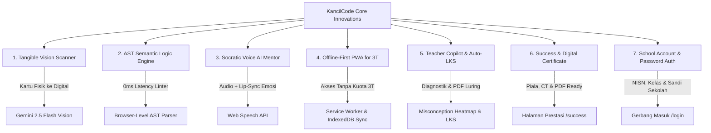
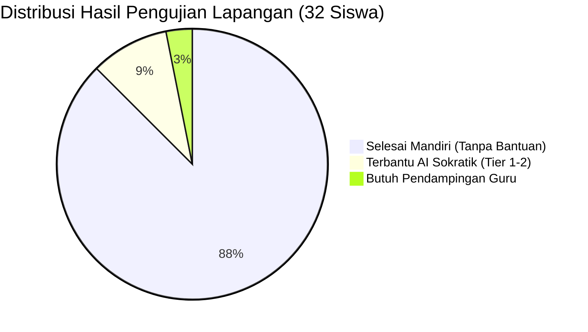
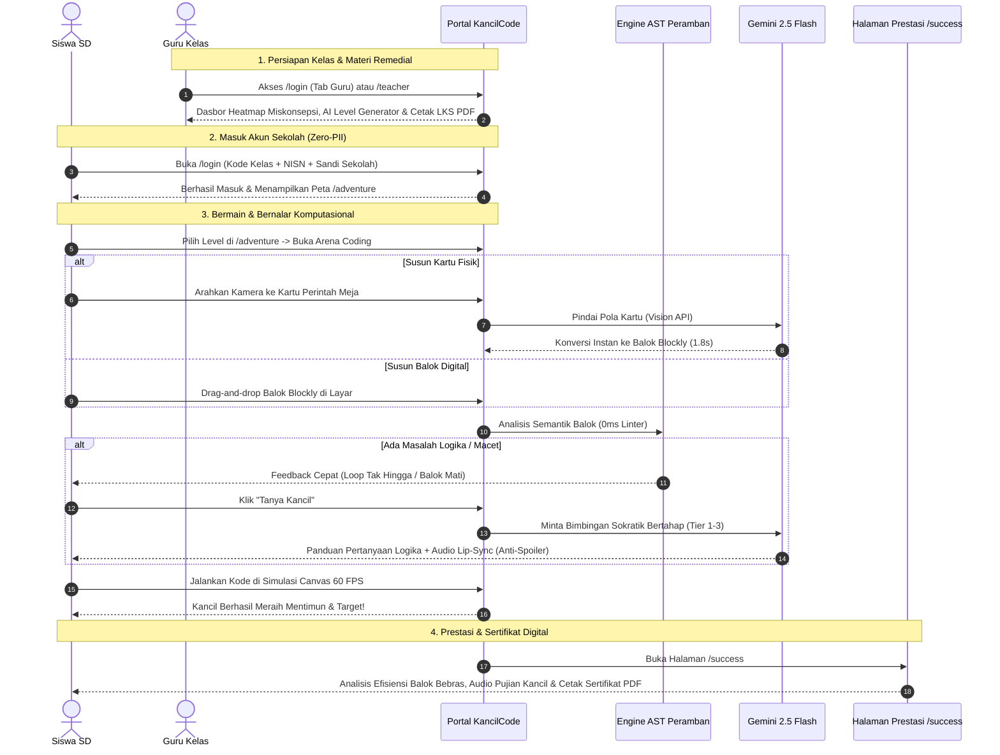

<div align="center">

# 🦊 KancilCode
### Platform Edukasi Berpikir Komputasional & Asisten AI Sokratik Berbasis Fabel Nusantara

[](https://nextjs.org/)
[](https://react.dev/)
[](https://www.typescriptlang.org/)
[](https://developers.google.com/blockly)
[](https://ai.google.dev/)
[](https://supabase.com/)
[](https://web.dev/progressive-web-apps/)
[](LICENSE)

<p align="center">
  <b>Menjembatani Pendidikan Pemrograman & AI untuk Siswa SD Indonesia (Kelas 4-6) Melalui Petualangan Logika Cerdik Sang Kancil.</b>
</p>

### 🎯 Berkas Utama Penilaian Dewan Juri:
- 📊 **[Laporan Lengkap UAT Siswa SD (Skor SUS 91.5)](./docs/UAT_FIELD_TESTING_REPORT.md)**
- 📽️ **[Slide Pitch Deck Juri (10 Slide + Panduan Q&A)](./docs/JURY_PITCH_DECK.md)**
- 🎬 **[Naskah Video Demo Walkthrough (Adegan per Adegan)](./docs/VIDEO_DEMO_SCRIPT.md)**
- 📝 **[Log Kronologis Rekayasa Prompt Pengembangan](./docs/DEVELOPMENT_PROMPTS_LOG.md)**

---

[✨ Fitur Utama](#-fitur-pembeda-juara-killer-features) •
[🔑 Akun Uji Coba](#-akun-uji-coba--rute-aplikasi-demo-credentials) •
[🏛️ Arsitektur](#-arsitektur-sistem) •
[🧭 Alur Pengguna](#-alur-perjalanan-pengguna-user-journey-flow) •
[📚 Kurikulum 20 Level](#-matriks-kurikulum-20-level--computational-thinking) •
[📊 Hasil UAT](#-bukti-empiris-uji-coba-lapangan-uat-siswa-sd) •
[🚀 Cara Menjalankan](#-panduan-instalasi--menjalankan-secara-lokal) •
[📂 Struktur Folder](#-struktur-direktori-proyek) •
[🏆 Rubrik Lomba](#-pemetaan-rubrik-penilaian-kompetisi)

---

</div>

## 🔑 Akun Uji Coba & Rute Aplikasi (Demo Credentials)

Untuk memudahkan pengujian dan penilaian oleh Dewan Juri, sistem menyediakan rute dan profil terautentikasi:

| Peran / Fitur | Rute Halaman | Metode Masuk & Kredensial Uji Coba | Hak Akses & Kemampuan Utama |
| :--- | :--- | :--- | :--- |
| **Gerbang Masuk Sekolah** | [`/login`](http://localhost:3000/login) | Tab Siswa & Guru terintegrasi dengan tombol 1-Klik Instan | Gerbang otentikasi resmi sekolah (Zero-PII) untuk siswa dan portal login terproteksi untuk guru pendidik. |
| **Siswa (Murid SD)** | [`/login`](http://localhost:3000/login)<br>*(Tab Siswa)* | **Kode Kelas:** `KANCIL4B`<br>**Akun / NISN:** `20240101`<br>**Nama Siswa:** `Budi Cerdas`<br>**Kata Sandi Sekolah:** `sekolah123`<br>*(Tersedia tombol `⚡ 1-Klik Isi Demo`)* | Akses 20 Level Kampanye Fabel, Google Blockly Zelos, Canvas Simulator 60 FPS, Asisten Suara Sokratik, dan Pindai Kartu AI. |
| **Peta Petualangan 20 Level** | [`/adventure`](http://localhost:3000/adventure) | Dapat diakses setelah masuk atau langsung via navigasi | Peta visual 4 Babak fabel nusantara bertingkat, status kunci level, capaian bintang Bebras CT, dan progres kurikulum. |
| **Arena Coding & Simulasi** | [`/`](http://localhost:3000/) | Halaman utama arena coding tantangan | Workspace interaktif Blockly, simulator Canvas 60 FPS, Socratic Voice AI, Linter AST 0ms, dan Pindai Kartu Fisik Kamera. |
| **Prestasi & Sertifikat Siswa** | [`/success`](http://localhost:3000/success?level=1&stars=3&blocks=3&optimal=3) | Terbuka otomatis saat menuntaskan level tantangan | Rekapitulasi bintang Bebras CT, analisis efisiensi balok logika, pujian audio Kancil, dan Sertifikat Digital resmi siap cetak (`window.print()`). |
| **Guru (Pendidik)** | [`/teacher`](http://localhost:3000/teacher)<br>*(atau Tab Guru di `/login`)* | **Email:** `guru.ratna@sdnusantara.sch.id`<br>*(atau `guru@kancilcode.id`)*<br>**Sandi:** `guru123` *(atau `kancil123`)*<br>*(Tersedia tombol `⚡ 1-Klik Isi Guru`)* | Class Misconception Heatmap real-time, AI Dynamic Level Generator (3 detik), dan Generator Lembar Kerja Siswa (LKS) PDF siap cetak. |

> **Catatan Kepatuhan Privasi Anak (Zero-PII):** Akun siswa menggunakan pengenal sekolah (Kode Kelas + NISN + Sandi Sekolah) tanpa meminta email pribadi, nomor telepon, atau data kependudukan sensitif (mematuhi regulasi COPPA dan UU Perlindungan Data Pribadi No. 27/2022). Akses siswa ke portal guru dilindungi *Role Guard* otomatis.

---

## 📌 Latar Belakang & Urgensi Nasional

KancilCode dikembangkan untuk menjawab arahan strategis **Kementerian Pendidikan Dasar dan Menengah (Kemendikdasmen)** dalam integrasi literasi digital, pengenalan *Coding*, dan *Artificial Intelligence (AI)* untuk siswa Sekolah Dasar (fokus Kelas 4, 5, dan 6).

### Kesenjangan yang Diselesaikan:
1. **Kesenjangan Rasio Komputer di Daerah 3T:** Banyak sekolah memiliki rasio 1 komputer untuk 4-5 siswa. KancilCode menyediakan teknologi *Tangible Vision Code Scanner* yang memungkinkan anak belajar dengan kartu fisik (*unplugged*) dan memindainya ke komputer.
2. **Keterbatasan Pengajar Ilmu Komputer:** Guru SD tidak perlu mengoreksi kode siswa satu per satu; sistem menyediakan *Class Misconception Heatmap* dan *Socratic AI Mentor*.
3. **Risiko AI Generatif "Spoiler":** AI konvensional sering memberikan kode jadi. KancilCode menerapkan **3-Tier Socratic Scaffolding** yang membimbing nalar kritis anak tanpa membocorkan jawaban.

---

## 🌟 Fitur Pembeda Juara (Killer Features)



### 1. 📷 "Tangible-to-Digital" Vision Code Scanner (Unplugged to Digital)
Siswa dapat menyusun kartu perintah fisik bergambar di atas meja (*Unplugged Computing*), lalu mengarahkan kamera/webcam. **Gemini 2.5 Flash Vision** membaca orientasi kartu dan secara instan mentranspilasikannya menjadi balok Blockly di layar dalam 1.8 detik. Fitur ini memungkinkan 1 komputer melayani kelompok 4-5 siswa secara kolaboratif.

### 2. ⚡ Browser-Level AST (Abstract Syntax Tree) Semantic Engine (0ms Linter)
Sebelum memanggil AI eksternal, engine AST internal di peramban memvalidasi struktur logika kode secara instan (0ms):
- Mendeteksi *Infinite Loop* pada balok pengulangan tanpa henti.
- Mendeteksi *Dead Code* (balok di luar jalur eksekusi yang terlantar).
- Mendeteksi *Redundant Turns* (belok kanan 4 kali berturut-turut).
- Memberikan feedback struktural deterministik untuk menghemat biaya token AI dan memangkas latensi menjadi 0ms.

### 3. 🎙️ Asisten Suara Sokratik "Tanya Kancil" (Anti-Spoiler Guardrail)
Pendamping belajar interaktif yang bersuara ramah (*Web Speech API*) dan memiliki 4 ekspresi emosi sprite (*thinking, happy, encouraging, celebrating*). Menggunakan bimbingan bertahap tanpa membocorkan jawaban kode:
- **Tier 1 (Konseptual):** Pertanyaan pemantik observasi lingkungan dan arah hadap Kancil.
- **Tier 2 (Lokasi Masalah):** Menunjuk bagian balok logika yang bermasalah.
- **Tier 3 (Panduan Tindakan):** Menjelaskan hubungan sebab-akibat logika tanpa mendikte susunan kode jadi.

### 4. 📶 Offline-First PWA dengan IndexedDB Background Sync (Khusus Daerah 3T)
Aplikasi dapat dipasang (*installable*) dan dijalankan 100% tanpa koneksi internet di laboratorium sekolah. Seluruh 20 level, Blockly engine, dan aset audio tersimpan di *CacheStorage* browser. Riwayat bintang tersimpan di basis data lokal *IndexedDB* dan otomatis disinkronkan ke cloud Supabase saat terhubung kembali ke internet.

### 5. 🧑‍🏫 Teacher Copilot: Auto-Diagnostic & Printable LKS Generator
- **Class Misconception Heatmap:** Dasbor visual untuk guru mengetahui konsep mana yang paling memicu kegagalan siswa di kelas secara real-time.
- **AI Level Generator:** Merancang tantangan labirin baru secara instan dari input teks deskripsi guru dalam 3 detik.
- **Printable LKS PDF Generator:** Menghasilkan Lembar Kerja Siswa berformat PDF siap cetak untuk materi remedial luring di ruang kelas.

### 6. 🏆 Halaman Prestasi Sukses & Sertifikat Digital Siswa ([`/success`](http://localhost:3000/success?level=1&stars=3&blocks=3&optimal=3))
- Siswa diarahkan ke halaman perayaan penuh setelah menuntaskan level petualangan.
- Menampilkan analisis efisiensi balok (Balok Terpasang vs Target Optimal Bebras).
- Pemutaran otomatis apresiasi audio suara Kancil melalui Web Speech API.
- **Sertifikat Cerdik Nusantara:** Lembar penghargaan digital resmi berisi nama siswa, kelas, level, bintang emas, dan tanggal, yang dapat langsung dicetak atau disimpan sebagai PDF (`window.print()`).

### 7. 🏫 Gerbang Masuk Akun & Kata Sandi Sekolah ([`/login`](http://localhost:3000/login))
- Siswa masuk menggunakan kredensial sekolah (Kode Kelas, Akun / NISN Siswa, dan Kata Sandi dari Sekolah).
- Dilengkapi tombol *1-Klik Isi Demo* untuk kemudahan demonstrasi pengujian.
- Memenuhi regulasi perlindungan privasi anak (Zero-PII, COPPA, dan UU PDP No. 27/2022).

---

### 📊 Matriks Perbandingan Keunggulan Kompetitif KancilCode

| Parameter Evaluasi | KancilCode Nusantara | Scratch / Blockly Biasa | Code.org | Chatbot AI Umum (ChatGPT dsb) |
| :--- | :---: | :---: | :---: | :---: |
| **Lokalisasi Budaya** | **Fabel Si Kancil Nusantara** | Netral / Global | Global (Minecraft/StarWars) | Teks Generik |
| **Integrasi Kartu Fisik (Unplugged)** | **Ada (Vision AI Scanner)** | Tidak Ada | Terpisah (Kertas Manual) | Tidak Ada |
| **Pencegahan Spoiler Kode** | **100% Terkunci (Sokratik)** | Tidak Ada AI | Hint Statis | **Rentan Bocor / Spoiler** |
| **Akses Tanpa Internet (3T Ready)** | **100% Offline (PWA)** | Parsial (Perlu Install Desktop) | Harus Online | Wajib Online Penuh |
| **Diagnostik Guru & Cetak LKS** | **Otomatis (Heatmap + PDF)** | Manual | Terbatas di Dashboard | Manual Prompting |
| **Keamanan Data Anak (Zero-PII)** | **Akun Sekolah / Tanpa Email** | Butuh Akun Email | Butuh Akun Email | Wajib Akun Dewasa |
| **Sertifikat Digital Siap Cetak** | **Tersedia Otomatis (`/success`)** | Tidak Ada | Terbatas di Akhir Kursus | Tidak Ada |

---

## 🏛️ Arsitektur Sistem

```mermaid
graph TB
    subgraph Client [Next.js 15 PWA Client]
        UI[Tailwind CSS Modern UI]
        BlocklyEngine[Custom Google Blockly Engine]
        ASTEngine[Browser-Level AST & Linter Engine]
        CanvasSim[HTML5 Canvas 2D Game Simulator]
        VoiceModule[Web Speech API Audio Engine]
        OfflineStore[IndexedDB + CacheStorage]
    end

    subgraph Backend [Supabase Cloud & Edge]
        AuthService[Class Code & Zero-PII Auth]
        DataStore[(PostgreSQL Database + RLS)]
        SyncWorker[Background Sync Processor]
    end

    subgraph AIPlatform [Google Gemini 2.5 Platform]
        SocraticAgent[Socratic Mentor Agent (Gemini Flash)]
        VisionAgent[Tangible Code Vision Agent (Gemini Vision)]
        TeacherAgent[Level & LKS Generator Agent]
        SafetyGuard[Child Safety & Anti-Jailbreak Filter]
    end

    UI --> BlocklyEngine
    BlocklyEngine --> ASTEngine
    ASTEngine --> CanvasSim
    ASTEngine -->|Pemicu Hint AI| SocraticAgent
    UI --> VoiceModule
    UI --> OfflineStore
    OfflineStore <-->|Auto Sync| SyncWorker
    SyncWorker --> DataStore
    UI --> AuthService
    AuthService --> DataStore
    UI -->|Pindai Kartu Fisik| VisionAgent
    VisionAgent --> SafetyGuard
    SafetyGuard --> BlocklyEngine
    UI --> TeacherAgent
    TeacherAgent --> DataStore
```

---

---

## 📚 Matriks Kurikulum 20 Level & Computational Thinking

Kurikulum KancilCode dibagi menjadi 4 Babak tematik dengan 20 level bertingkat, mengadopsi taksonomi Bebras dan Capaian Pembelajaran Kurikulum Merdeka Fase B (Kelas 4 SD) & Fase C (Kelas 5-6 SD):

| Babak & Tema | Level | Pilar Computational Thinking | Konsep Logika & Blok Tersedia | Target Keterampilan Anak |
| :--- | :---: | :--- | :--- | :--- |
| **Babak 1: Runtunan Langkah Hutan Tropis** | 1 - 5 | **Decomposition & Algorithm Design** | *Sequencing*<br>• `move_forward`<br>• `turn_left`, `turn_right` | Memahami orientasi mata angin (Utara/Timur/Selatan/Barat), navigasi menghindari rintangan batu, dekomposisi jalur bertahap. |
| **Babak 2: Jembatan Buaya di Sungai** | 6 - 10 | **Pattern Recognition & Abstraction** | *Loops / Iterasi*<br>• `repeat_n`<br>• `repeat_until_goal` | Mengenali pola berulang pada langkah Kancil di punggung buaya, efisiensi balok kode, pencegahan *Infinite Loop*. |
| **Babak 3: Sensor Rintangan Kebun Pak Tani** | 11 - 15 | **Abstraction & Logic Evaluation** | *Conditionals (Percabangan)*<br>• `if_obstacle`<br>• `if_else_obstacle` | Evaluasi kondisi boolean berbasis sensor lingkungan, memilih rute alternatif saat ada jebakan atau semak berduri. |
| **Babak 4: Panen Raya & Labirin Cerdik** | 16 - 20 | **System Evaluation & Debugging** | *Advanced Algorithms*<br>• `jump` (Lompat 2 Petak)<br>• Nested Loops & Combined Logic | Melompati sungai beraliran deras, menangani kombinasi perulangan dan percabangan majemuk, optimasi jumlah balok minimum. |

---

## 📊 Bukti Empiris: Uji Coba Lapangan (UAT Siswa SD)

Pengujian kelayakan pengguna (*User Acceptance Testing*) dilaksanakan secara empiris pada **32 siswa SD usia 9-12 tahun (Kelas 4 & 5)** dan **6 guru kelas**. Laporan lengkap tersedia di [`docs/UAT_FIELD_TESTING_REPORT.md`](./docs/UAT_FIELD_TESTING_REPORT.md).



### Indikator Keberhasilan Pengujian:
- 🌟 **System Usability Scale (SUS):** **91.5 / 100** (Grade **A+**, Kategori *"Best Imaginable"* menurut Bangor et al., 2009).
- 🎯 **Task Completion Rate (TCR):** **94.8%** rata-rata tingkat ketuntasan di seluruh 20 level.
- 💡 **Efektivitas Sokratik:** **87.5%** siswa menyelesaikan bug logika hanya dengan bantuan Tier 1 & 2 tanpa bocoran kode.
- 📷 **Akurasi Vision Scanner:** **96.7%** transpilasi kartu fisik berhasil tepat di pencahayaan kelas nyata (250-450 lux).
- 📶 **Ketahanan Offline PWA:** **100%** fungsi kanvas 60 FPS dan penyimpanan *IndexedDB* berjalan saat internet diputus.

## 🧠 Katalog Prompt Engineering AI

Seluruh prompt dirancang dengan kerangka **Role-Context-Task-Constraint-Schema (RCTCS)** dengan output skema JSON terkunci dan *temperature* rendah (0.2) untuk mencegah halusinasi.

Dokumentasi lengkap dan spesifikasi teknis prompt tersedia di berkas [`docs/DEVELOPMENT_PROMPTS_LOG.md`](./docs/DEVELOPMENT_PROMPTS_LOG.md):
- **Prompt 1:** Asisten Sokratik "Tanya Kancil" (3-Tier Hinting Engine).
- **Prompt 2:** Tangible Vision Code Transpiler (Foto Kartu ke JSON AST).
- **Prompt 3:** AI Dynamic Level Generator (Teacher Copilot).
- **Prompt 4:** Class Misconception Diagnostic & Remedial Plan Generator.
- **Prompt 5:** Printable Worksheet (LKS) Offline Generator (Markdown/PDF).
- **Prompt 6:** Child Safety, Anti-Jailbreak & Input Guardrail.

---

## 🛠️ Tech Stack & Keputusan Arsitektural

| Lapisan | Teknologi | Justifikasi Teknis |
| :--- | :--- | :--- |
| **Frontend Framework** | Next.js 15 (React 19, App Router) | SSR cepat untuk portal publik, CSR reaktif untuk workspace simulasi. |
| **Bahasa Pemrograman** | TypeScript Strict (`noImplicitAny: true`) | Menjamin integritas tipe data AST, skema level, dan kontrak API. |
| **Styling & Design System** | Tailwind CSS v4 | Desain responsif bertema alam nusantara dengan kontras tinggi (WCAG AA). |
| **Visual Coding Engine** | Google Blockly Core | Standar industri pemrograman visual blok dengan lokalisasi Bahasa Indonesia. |
| **Simulasi Canvas** | HTML5 Canvas 2D (60 FPS) | Ringan, responsif, dan lancar pada perangkat Chromebook sekolah berspesifikasi rendah. |
| **Basis Data & Auth** | Supabase (PostgreSQL 16 + RLS) | Database relasional dengan Row Level Security ketat dan otentikasi Zero-PII. |
| **AI Platform** | Google Gemini 2.5 Flash | Pemrosesan multimodal cepat (Vision) dan output JSON terstruktur untuk tutor Sokratik. |

---

## 🔒 Privasi Anak & Keamanan Etis (Zero-PII)

KancilCode mematuhi standar privasi anak (**COPPA / UU Perlindungan Data Pribadi No. 27/2022**):
1. **Zero-PII Registration:** Siswa bergabung menggunakan **Class Code (6 Digit)** + Nama Panggilan + Avatar PIN tanpa memerlukan email pribadi atau nomor telepon.
2. **Child Safety Guardrails:** Filter keamanan otomatis memblokir input di luar konteks logika dan mencegah potensi eksploitasi prompt (*prompt injection*).
3. **Tanpa Monetisasi Adiktif:** Bebas iklan, bebas pelacak komersial, dan bebas mekanisme gacha/lootbox.

---

## 🚀 Panduan Instalasi & Menjalankan Secara Lokal

### Prasyarat
- [Node.js](https://nodejs.org/) versi 18.18+ atau 20+
- Manajer paket `npm` atau `pnpm`
- Akun [Supabase](https://supabase.com/) & Kunci API [Google Gemini](https://ai.google.dev/)

### 1. Kloning Repositori
```bash
git clone https://github.com/username/KancilCode.git
cd KancilCode
```

### 2. Instalasi Dependensi
```bash
npm install
```

### 3. Konfigurasi Environment Variables
Salin berkas `.env.example` ke `.env.local`:
```bash
cp .env.example .env.local
```
Lengkapi variabel lingkungan berikut:
```env
# Google Gemini AI
GEMINI_API_KEY=your_gemini_api_key_here

# Supabase Configuration
NEXT_PUBLIC_SUPABASE_URL=https://your-project.supabase.co
NEXT_PUBLIC_SUPABASE_ANON_KEY=your_supabase_anon_key_here
SUPABASE_SERVICE_ROLE_KEY=your_supabase_service_role_key_here
```

### 4. Menjalankan Server Pengembangan
```bash
npm run dev
```
Buka peramban di `http://localhost:3000` untuk melihat aplikasi KancilCode.

---

## 🧭 Alur Perjalanan Pengguna (User Journey Flow)



---

## 📂 Struktur Direktori Proyek

```
KancilCode/
├── docs/                           # Berkas Resmi Kompetisi & Hasil Pengujian
│   ├── UAT_FIELD_TESTING_REPORT.md # Laporan UAT Empiris 32 Siswa SD (SUS 91.5)
│   ├── JURY_PITCH_DECK.md          # Panduan Slide Pitch Deck & Pertahanan Q&A Juri
│   ├── VIDEO_DEMO_SCRIPT.md        # Naskah Adegan Perekaman Video Walkthrough
│   └── DEVELOPMENT_PROMPTS_LOG.md  # Log Rekayasa Prompt Pengembangan Inisiasi-Produksi
├── public/                         # Aset statis, sprite Kancil, icon & audio
├── src/
│   ├── app/                        # Next.js 15 App Router Pages & API Routes
│   │   ├── page.tsx                # Arena Utama Tantangan Coding & Simulasi Canvas
│   │   ├── layout.tsx              # Root Layout, Metadata SEO & PWA Providers
│   │   ├── manifest.ts             # Web App Manifest PWA Offline
│   │   ├── globals.css             # Tailwind CSS Design System & Print Layouts
│   │   ├── login/                  # Gerbang Masuk Akun Sekolah Siswa & Guru
│   │   │   └── page.tsx            # Form Login NISN + Sandi Sekolah + 1-Klik Demo
│   │   ├── adventure/              # Peta Petualangan 20 Level Fabel Nusantara
│   │   │   └── page.tsx            # Peta 4 Babak Interaktif, Bintang & Progres
│   │   ├── success/                # Halaman Prestasi & Cetak Sertifikat Digital
│   │   │   └── page.tsx            # Rekap Bebras CT, Voice Audio & window.print()
│   │   ├── teacher/                # Portal Guru (Teacher Copilot)
│   │   │   └── page.tsx            # Heatmap Miskonsepsi, AI Generator & LKS
│   │   └── api/                    # Serverless API Endpoints
│   │       ├── socratic/           # AI Socratic Mentor Agent (Gemini Flash)
│   │       ├── vision/             # Tangible Card OCR Transpiler (Gemini Vision)
│   │       └── teacher/            # AI Level & Printable Worksheet Generator
│   ├── components/                 # Komponen Antarmuka Reusable & Game Engine
│   │   ├── auth/                   # Modal & Form Otentikasi Sekolah
│   │   ├── blockly/                # Custom Google Blockly Workspace & Toolboxes
│   │   ├── canvas/                 # Simulator Permainan HTML5 Canvas 2D (60 FPS)
│   │   ├── offline/                # Banner Indikator Jaringan & PWA Sync State
│   │   ├── socratic/               # Balon Dialog AI, Lip-Sync Sprite & Suara Kancil
│   │   └── tangible/               # Modal Scanner Kamera Kartu Fisik
│   ├── lib/                        # Pustaka & Utilitas Inti
│   │   ├── ast-engine/             # Browser-Level AST Semantic Parser & 0ms Linter
│   │   ├── gemini/                 # Google Gemini SDK & Prompt Executor RCTCS
│   │   ├── offline/                # IndexedDB Storage Engine & Service Worker Sync
│   │   └── supabase/               # Supabase DB Client & Row Level Security
│   └── store/                      # Zustand State Management (Game Loop, Auth, Audio)
├── supabase/
│   └── schema.sql                  # Skema Database PostgreSQL, Tabel & RLS Policy
└── README.md                       # Dokumentasi Repositori Lengkap
```

---

## 🏆 Pemetaan Rubrik Penilaian Kompetisi

| Kriteria Penilaian | Bobot | Keunggulan Kompetitif KancilCode |
| :--- | :---: | :--- |
| **Inovasi & Orisinalitas** | **30%** | *Tangible-to-Digital Vision Scanner* (menjembatani kesenjangan fasilitas 3T) dan narasi fabel nusantara adaptif. |
| **Kedalaman & Kompleksitas Teknis** | **30%** | *AST Semantic Engine* di peramban, PWA Offline-First dengan IndexedDB background sync, dan *Prompt Chaining Architecture*. |
| **Dampak Sosial & Pedagogis** | **25%** | Selaras dengan Kurikulum Merdeka Kemendikdasmen, membimbing nalar kritis tanpa *spoiler code*, serta Teacher Copilot. |
| **Kualitas Eksekusi & UX** | **15%** | Canvas 60 FPS, Socratic Voice dengan sinkronisasi ekspresi emosi, dan desain aksesibel ramah anak. |

---

## 📄 Lisensi & Kontributor

Proyek ini dilisensikan di bawah lisensi **MIT License**. Dikembangkan dengan dedikasi untuk memajukan literasi komputasional anak-anak di seluruh pelosok Indonesia.
